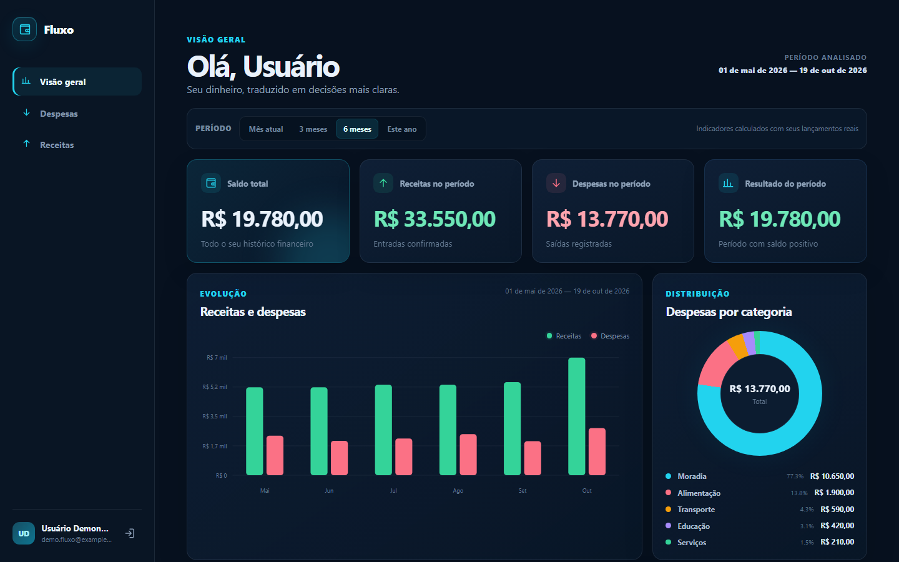
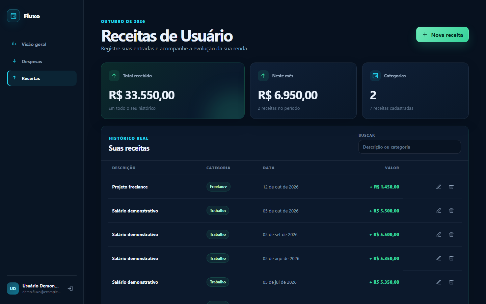
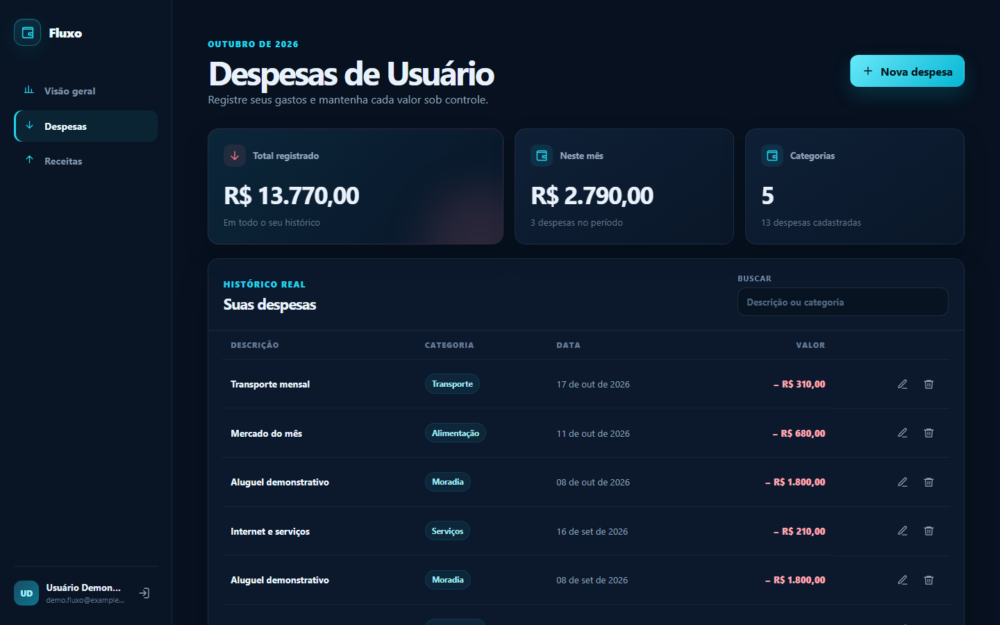
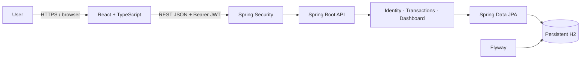

# Fluxo — Personal Finance Manager

[Portuguese version](README.md) · [Architecture](docs/architecture.md) · [Screenshot guide](docs/screenshots/README.md)

**Fluxo** is a full-stack web application for personal finance management. It demonstrates an end-to-end implementation of user registration and authentication, authorization rules, persistence, REST APIs, a responsive interface, and integration tests.

The MVP runs locally without external infrastructure: Spring Boot uses a persistent H2 database and React consumes the real API. PostgreSQL remains available only as a future environment option.

## Interface

### Financial dashboard



### Authentication


### Income and expenses

<p align="center">
  
  
</p>

All screenshots use a dedicated demo account and fictional transactions.

## Features

- user registration and login with BCrypt password hashing;
- stateless JWT authentication;
- complete income and expense CRUD;
- authenticated-user data isolation;
- dashboard with total balance, income, expenses, and period result;
- monthly income versus expense chart;
- expense distribution by category;
- recent transactions and period filters;
- frontend and backend validation;
- consistent API error responses;
- interactive OpenAPI/Swagger documentation;
- responsive dark navy and cyan interface, with green for income.

## Architecture



The backend is a **feature-oriented modular monolith**. Controllers define the HTTP contract, services own business rules and transaction boundaries, repositories isolate persistence, and DTOs prevent entities from leaking into the API.

See [docs/architecture.md](docs/architecture.md) for component and authentication-flow diagrams.

## Tech stack

| Area | Technologies |
| --- | --- |
| Backend | Java 21, Spring Boot 3.5, Spring Web, Spring Security |
| Data | Spring Data JPA, Hibernate, Flyway, H2 |
| Security | HS256 JWT, BCrypt, ownership-based authorization |
| Frontend | React 19, TypeScript, Vite, responsive CSS |
| API | REST, Bean Validation, OpenAPI/Swagger |
| Quality | JUnit 5, Spring Boot Test, MockMvc, Maven, TypeScript |
| Automation | GitHub Actions for security audit, tests, and build |

## Run locally

### Requirements

- Java 21;
- Node.js 22.12 or newer;
- Git.

Docker and PostgreSQL are **not required** for the default local environment.

### 1. Clone

```bash
git clone https://github.com/geanrf/fluxo-financeiro.git fluxo
cd fluxo
```

### 2. Start the backend

Windows PowerShell:

```powershell
cd backend
.\mvnw.cmd spring-boot:run
```

Linux or macOS:

```bash
cd backend
bash ./mvnw spring-boot:run
```

The default `dev` profile creates the database at `.local/h2/finance`. This directory is local and ignored by Git.

### 3. Start the frontend

In another terminal:

```bash
cd frontend
npm ci
npm run dev
```

### 4. Open

- application: http://localhost:5173
- Swagger UI: http://localhost:8080/swagger-ui.html
- OpenAPI JSON: http://localhost:8080/api-docs
- health check: http://localhost:8080/actuator/health

There is no default account. Use the account creation option on the first run. Passwords must contain 8–72 characters, including an uppercase letter, a lowercase letter, and a number.

## Main endpoints

| Method | Endpoint | Purpose |
| --- | --- | --- |
| `POST` | `/api/v1/auth/register` | Create an account |
| `POST` | `/api/v1/auth/login` | Authenticate |
| `GET` | `/api/v1/auth/me` | Get the authenticated user |
| `GET/POST` | `/api/v1/incomes` | List or create income |
| `GET/PUT/DELETE` | `/api/v1/incomes/{id}` | Read, update, or delete income |
| `GET/POST` | `/api/v1/expenses` | List or create expenses |
| `GET/PUT/DELETE` | `/api/v1/expenses/{id}` | Read, update, or delete an expense |
| `GET` | `/api/v1/dashboard?from=YYYY-MM-DD&to=YYYY-MM-DD` | Period indicators |

Financial endpoints require `Authorization: Bearer <token>`.

## Tests and build

Backend — 16 automated tests covering authentication, validation, CRUD operations, dashboard calculations, and user isolation:

```powershell
cd backend
.\mvnw.cmd test
```

Frontend — static type checking and production bundle:

```bash
cd frontend
npm run typecheck
npm run build
```

The [`.github/workflows/ci.yml`](.github/workflows/ci.yml) workflow runs the security audit, backend tests, and frontend build on every push or pull request.

## Project structure

```text
fluxo/
├── backend/               # Spring Boot API and integration tests
├── frontend/              # React application
├── docs/                  # Architecture, audit, and screenshot guide
├── tools/                 # Repository security checks
└── .github/workflows/     # Continuous integration
```

## Security

- passwords are stored only as BCrypt hashes;
- JWT access tokens expire and are not persisted by the backend;
- every financial query includes the authenticated user's identifier;
- `.env`, H2 databases, caches, dependencies, and build artifacts are ignored;
- the default profile requires no real credentials;
- CI checks the Git history for forbidden files and high-risk secret patterns.

The latest repository review is documented in [docs/security-audit.md](docs/security-audit.md).

## Project status

Published and functional MVP with authentication, income, expenses, and a dashboard integrated with the real API. The project is available on [GitHub](https://github.com/geanrf/fluxo-financeiro) as a Java Full Stack portfolio project.
