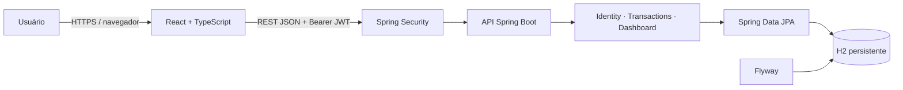

# Fluxo — Gestão Financeira Pessoal

[English version](README.en.md) · [Arquitetura](docs/architecture.md) · [Guia de screenshots](docs/screenshots/README.md)

O **Fluxo** é uma aplicação web full stack para controle financeiro pessoal. O projeto demonstra, de ponta a ponta, cadastro e autenticação de usuários, regras de autorização, persistência, APIs REST, interface responsiva e testes de integração.

O MVP funciona localmente sem infraestrutura externa: o Spring Boot utiliza um banco H2 persistente e o React consome a API real. PostgreSQL permanece disponível apenas como alternativa futura de ambiente.

## Interface

### Dashboard financeiro


### Autenticação


### Receitas e despesas

<p align="center">
  
  
</p>

Todas as imagens usam uma conta demonstrativa e movimentações fictícias.

## Funcionalidades

- cadastro e login com senha protegida por BCrypt;
- autenticação stateless com JWT;
- CRUD completo de receitas e despesas;
- isolamento de dados por usuário autenticado;
- dashboard com saldo total, receitas, despesas e resultado do período;
- gráfico mensal de receitas e despesas;
- distribuição de despesas por categoria;
- últimas movimentações e filtros de período;
- validações no frontend e no backend;
- respostas de erro padronizadas;
- documentação interativa da API com OpenAPI/Swagger;
- interface responsiva em azul-escuro, ciano e verde para entradas.

## Arquitetura



O backend segue um **monólito modular por funcionalidades**. Controllers cuidam do contrato HTTP, services concentram regras e transações, repositories isolam a persistência e DTOs impedem que entidades sejam expostas diretamente.

Detalhes, fluxo de autenticação e decisões técnicas estão em [docs/architecture.md](docs/architecture.md).

## Tecnologias

| Camada | Tecnologias |
| --- | --- |
| Backend | Java 21, Spring Boot 3.5, Spring Web, Spring Security |
| Dados | Spring Data JPA, Hibernate, Flyway, H2 |
| Segurança | JWT com HS256, BCrypt, validação de propriedade por usuário |
| Frontend | React 19, TypeScript, Vite, CSS responsivo |
| API | REST, Bean Validation, OpenAPI/Swagger |
| Qualidade | JUnit 5, Spring Boot Test, MockMvc, Maven, TypeScript |
| Automação | GitHub Actions para auditoria, testes e build |

## Executar localmente

### Pré-requisitos

- Java 21;
- Node.js 22.12 ou superior;
- Git.

Docker e PostgreSQL **não são necessários** para o ambiente local padrão.

### 1. Clonar o repositório

```bash
git clone <URL-DO-REPOSITORIO> fluxo
cd fluxo
```

### 2. Iniciar o backend

Windows PowerShell:

```powershell
cd backend
.\mvnw.cmd spring-boot:run
```

Linux ou macOS:

```bash
cd backend
bash ./mvnw spring-boot:run
```

O perfil padrão `dev` cria o banco em `.local/h2/finance`. Essa pasta é local e ignorada pelo Git.

### 3. Iniciar o frontend

Em outro terminal:

```bash
cd frontend
npm ci
npm run dev
```

### 4. Acessar

- aplicação: http://localhost:5173
- Swagger UI: http://localhost:8080/swagger-ui.html
- OpenAPI JSON: http://localhost:8080/api-docs
- health check: http://localhost:8080/actuator/health

Não existe usuário padrão. Na primeira execução, selecione **Criar conta**. A senha precisa ter de 8 a 72 caracteres e conter letra maiúscula, letra minúscula e número.

## Endpoints principais

| Método | Endpoint | Descrição |
| --- | --- | --- |
| `POST` | `/api/v1/auth/register` | Criar conta |
| `POST` | `/api/v1/auth/login` | Autenticar |
| `GET` | `/api/v1/auth/me` | Obter usuário autenticado |
| `GET/POST` | `/api/v1/incomes` | Listar ou criar receitas |
| `GET/PUT/DELETE` | `/api/v1/incomes/{id}` | Consultar, editar ou excluir receita |
| `GET/POST` | `/api/v1/expenses` | Listar ou criar despesas |
| `GET/PUT/DELETE` | `/api/v1/expenses/{id}` | Consultar, editar ou excluir despesa |
| `GET` | `/api/v1/dashboard?from=AAAA-MM-DD&to=AAAA-MM-DD` | Indicadores do período |

Os endpoints financeiros exigem `Authorization: Bearer <token>`.

## Testes e build

Backend — 16 testes automatizados cobrindo autenticação, validações, CRUDs, cálculos do dashboard e isolamento entre usuários:

```powershell
cd backend
.\mvnw.cmd test
```

Frontend — verificação estática e bundle de produção:

```bash
cd frontend
npm run typecheck
npm run build
```

O workflow [`.github/workflows/ci.yml`](.github/workflows/ci.yml) executa a auditoria de segredos, os testes do backend e o build do frontend em cada push ou pull request.

## Estrutura do projeto

```text
fluxo/
├── backend/
│   ├── src/main/java/com/portfolio/finance/
│   │   ├── identity/       # cadastro, login, JWT e usuário
│   │   ├── transaction/    # entidade e regras compartilhadas
│   │   ├── income/         # API de receitas
│   │   ├── expense/        # API de despesas
│   │   ├── dashboard/      # indicadores e agregações
│   │   └── shared/         # segurança, OpenAPI e erros
│   ├── src/main/resources/db/migration/
│   └── src/test/
├── frontend/
│   └── src/
│       ├── app/
│       ├── features/
│       └── shared/
├── docs/
├── tools/
└── .github/workflows/
```

## Segurança

- senhas são armazenadas somente como hash BCrypt;
- tokens JWT têm expiração e não são persistidos no backend;
- toda consulta financeira inclui o identificador do usuário autenticado;
- `.env`, bancos H2, caches, dependências e artefatos de build estão no `.gitignore`;
- nenhuma credencial real é necessária para executar o perfil padrão;
- a CI verifica nomes de arquivos proibidos e padrões de segredo no histórico Git.

Veja o registro da auditoria em [docs/security-audit.md](docs/security-audit.md).

## Decisões que este projeto demonstra

- **Monólito modular:** separação clara sem a complexidade operacional de microsserviços para um MVP.
- **Cálculos no backend:** regras financeiras usam `BigDecimal` e não dependem de aritmética do navegador.
- **Flyway como fonte do esquema:** mudanças de banco são explícitas, reproduzíveis e versionadas.
- **H2 persistente no desenvolvimento:** onboarding rápido, mantendo a arquitetura compatível com PostgreSQL.
- **Gráficos sem dependência adicional:** SVG e CSS reduzem o bundle e mantêm controle de acessibilidade e identidade visual.

## Estado do projeto

MVP funcional e validado, com autenticação, receitas, despesas e dashboard integrados à API real. O repositório está preparado para publicação como projeto de portfólio.
