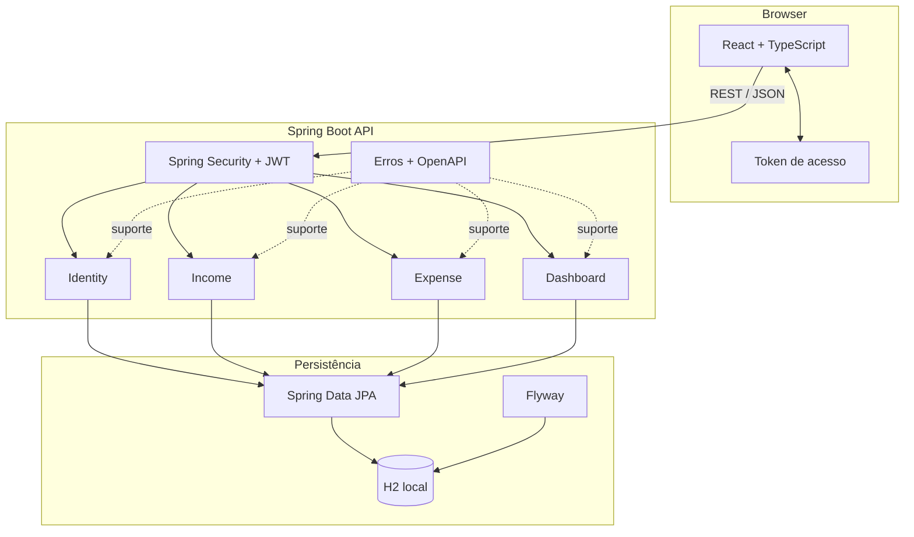
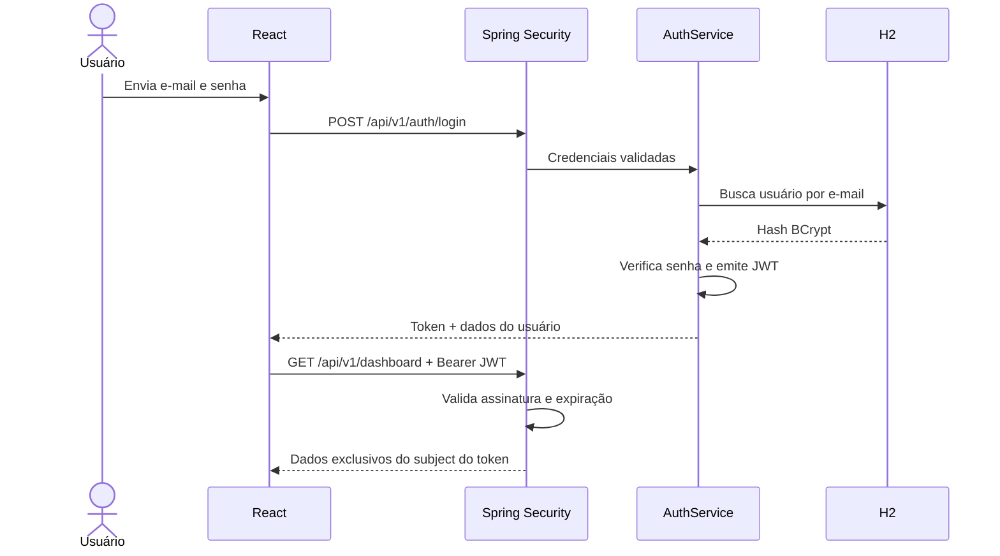
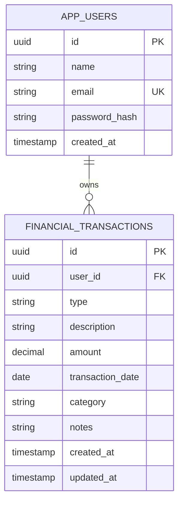

# Arquitetura do Fluxo

## Visão geral

O Fluxo é um monólito modular com frontend e backend separados. Essa escolha mantém o domínio organizado e o deploy simples, adequado ao tamanho atual do produto e fácil de explicar em uma entrevista técnica.

## Fluxo de autenticação

## Modelo de dados atual

Receitas e despesas compartilham a tabela `financial_transactions` e são diferenciadas por `type`. Isso evita duplicação no domínio e permite agregações eficientes no dashboard.

## Responsabilidades por camada

| Camada | Responsabilidade |
| --- | --- |
| React | interface, navegação, formulários, estados de carregamento e consumo da API |
| Controllers | contrato HTTP, status codes e obtenção do usuário autenticado |
| Services | regras, normalização, autorização por propriedade e limites transacionais |
| Repositories | consultas JPA sempre filtradas pelo identificador do proprietário |
| Flyway | criação e evolução reproduzível do esquema |
| Global error handler | resposta consistente sem expor detalhes internos |

## Decisões e trade-offs

- **H2 persistente no perfil `dev`:** reduz o tempo de onboarding. O perfil alternativo de PostgreSQL não é necessário para avaliar o MVP.
- **JWT stateless:** simplifica a API e demonstra Spring Security. No desenvolvimento, uma chave aleatória é criada a cada inicialização; reiniciar o backend invalida tokens antigos.
- **Token no `localStorage`:** solução simples para o portfólio. Em um produto exposto à internet, a evolução recomendada é usar cookie `HttpOnly`, `Secure` e `SameSite`, além de uma política CSP.
- **Consultas por proprietário:** o `userId` vem do subject do JWT, nunca do payload enviado pelo cliente.
- **`BigDecimal` no backend:** evita erros de ponto flutuante em valores monetários.
- **SVG/CSS nos gráficos:** evita uma dependência adicional e mantém o bundle pequeno.
- **Limite de 24 meses no dashboard:** impede consultas agregadas excessivas e mantém a visualização legível.

## Evolução possível

Paginação, refresh tokens, cookies seguros, testes de componentes React, observabilidade e deploy são evoluções naturais. Elas foram deixadas fora do MVP para manter o projeto funcional, objetivo e fácil de avaliar.
